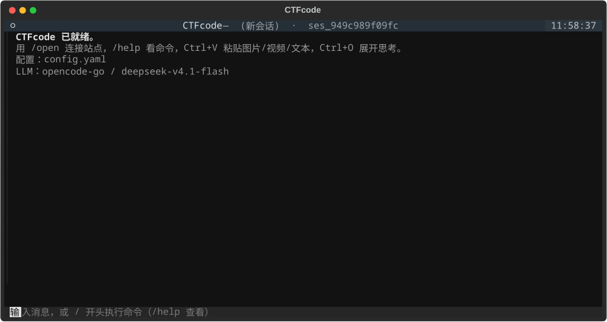

# CTFcode

[](https://github.com/lkjing2021345/CTFcode/actions/workflows/test.yml)
[](LICENSE)
[](https://www.python.org/)

A terminal CTF assistant: point it at a GZCTF instance and it will **detect the site → sign in → pull challenges → download attachments → start container targets → solve with an LLM that drives local CTF tools → submit the candidate flag after you confirm → draft a write-up**.



## Features

- **Terminal UI**: streaming reasoning, collapsible thinking/tool calls, `Esc` to abort, queued input while the agent is busy.
- **Tool calling**: the model runs real commands (`file`, `strings`, `binwalk`, `radare2`, `gdb`, `pwntools`, `sqlmap`, `nmap`, …) inside a per-challenge workspace, guided by bundled skills.
- **MCP client**: connect external MCP servers (e.g. Burp Suite, IDA) over SSE / streamable HTTP / stdio.
- **Clipboard**: paste images / files / text; videos are split into frames and sent to the model.
- **Sessions**: persisted locally, resume on start, search, pick with arrow keys, export to Markdown.
- **Providers**: OpenCode Go, plain OpenAI-compatible endpoints, or custom providers from an opencode-style `providers.jsonc`.
- **Container challenges**: auto-start the instance and inject its entry point.

## Quick start

```bash
git clone https://github.com/lkjing2021345/CTFcode
cd CTFcode
python -m venv venv && source venv/bin/activate
pip install -r requirements.txt
cp config.example.yaml config.yaml   # set your LLM provider/key
./bin/ctfcode
```

## Configuration

```yaml
llm:
  # A) OpenCode Go (reuses your local `opencode auth login`)
  backend: "opencode-go"
  model: "deepseek-v4.1-flash"

  # C) custom provider (see providers.jsonc below)
  provider: ""
  variant: ""

  # B) plain OpenAI-compatible endpoint
  base_url: "https://api.deepseek.com/v1"
  api_key: ""

providers_file: ""   # default: ./providers.jsonc → ~/.config/opencode/opencode.jsonc
```

### Anthropic

Native Claude support (Messages API, tool use, images, extended thinking):

```yaml
llm:
  backend: "anthropic"
  model: "claude-sonnet-4-5"
  api_key: "sk-ant-..."   # or ANTHROPIC_API_KEY
  variant: "think"        # optional: extended thinking
```

### Custom providers (opencode-style)

```jsonc
{
  "providers": {
    "local": {
      "name": "Local Qwen",
      "settings": { "baseURL": "http://127.0.0.1:8080/v1" },
      "models": {
        "qwen38": {
          "name": "Qwen3.8-27B",
          "body": { "enable_thinking": true },
          "variants": [
            { "id": "think", "body": { "enable_thinking": true } },
            { "id": "nothink", "body": { "enable_thinking": false } }
          ]
        }
      }
    }
  }
}
```

Switch with `/models` or `/model provider/model#variant`.

## Keybindings

| Key | Action |
|---|---|
| `Ctrl+V` | Paste image / file / text (video → frames) |
| `Ctrl+X` | Leader panel: `n` new session, `l` sessions, `p` pick, `m` models, `c` MCP, `u` undo, `r` redo, `e` export, `f` find, `s` settings, `h` help |
| `Esc` | Abort the running turn |
| `PageUp` / `PageDown` | Scroll the transcript |
| `Ctrl+O` | Toggle thinking blocks |
| `Ctrl+Q` | Quit (also works inside dialogs) |

## Slash commands

`/open /games /game /challenges /challenge /start /close /solve /models /model /mcp /llm /settings /new /sessions /resume /pick /title /undo /redo /export /find /submit /writeup /clear /quit`

## MCP

```yaml
mcp:
  burp:
    transport: sse
    url: "http://127.0.0.1:9876"    # Burp's SSE endpoint is the root path
  ida:
    transport: sse
    url: "http://127.0.0.1:8745/sse"
```

## Tests

```bash
./venv/bin/python tests/smoke.py   # no network / LLM required
ruff check ctfcode main.py scripts
```

## License

MIT
